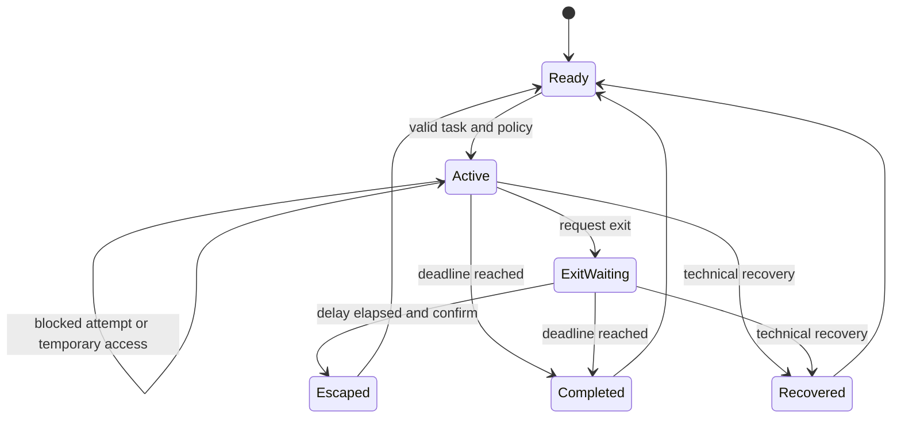

# Architecture and analysis

## Components

`core/engine.mjs` contains the policy as pure functions. It has no UI, network, Chrome, or storage dependency. Callers supply time in tests. The same source is copied into the extension during packaging.

`app/page.tsx` is the local React preview. It owns form state, session presentation, and localStorage persistence. It deliberately simulates navigation because a website cannot impose rules on unrelated browser tabs.

`extension/background.mjs` is the Manifest V3 background controller (Chromium service worker; Firefox module script). It owns persisted extension state, validates control messages, serializes updates, and reconciles browser rules. Popup and block pages send commands; they do not decide whether an exit or grant is permitted.

`extension/rules.mjs` converts active policy into declarative navigation rules. A low-priority HTTP(S) redirect catches disallowed main-frame requests; higher-priority escaped, anchored regular expressions allow hostnames or document URLs. Explicit blocked domains have the highest priority. Full fragments and SPA route changes are checked through webNavigation. Subresources are outside the rule scope.

`extension/ui.mjs` uses native browser controls, DOM text assignment, and runtime messages. It does not use remote code or inline script. The extension does not need the React application or its dependencies.

## State and time

The deadline is a timestamp, not a decremented counter. Closing a popup or reloading a page does not pause it. Access and exit deadlines are capped or checked against session state. A late completion reports only the planned duration. The first exit request fixes its deadline; repeated requests do not restart the wait.

The preview uses versioned localStorage. The extension uses `chrome.storage.local`, dynamic DNR rules, and an alarm for the next expiry. Dynamic rules survive worker termination and browser restart. On startup and events, expired sessions are archived and rules are recalculated. Chrome controls alarm timing; this is not exact real-time enforcement.

The service worker serializes commands to avoid lost updates. UI clocks are presentation only. The local preview synchronizes storage events between tabs, but localStorage is not a transactional multi-client database; simultaneous edits in separate preview tabs can race. Use the extension for browser enforcement.

## Safety, privacy, and limitations

All form inputs pass through policy validation. Task and reason lengths, durations, access limits, URL scheme and credentials, level membership, active state, and exit timing are checked. Destination matching uses parsed hostname equality, not substring matching. A hostile lookalike domain cannot inherit access.

Extension messages must originate from the extension’s own pages. No content script or externally-connectable origin is declared. User strings are rendered as React text or DOM `textContent`; no HTML injection API is used. DNR targets only HTTP(S). Privileged Chrome pages remain reachable for recovery.

No telemetry, authentication, cloud storage, server session API, or paid-feature check is implemented. Task titles, focus URLs, hostnames, and timestamps are personal data held locally. An export is a backup the user controls, not an anonymous analytics report. Typed access and exit reasons are not persisted.

A blocked destination is kept in temporary per-tab extension session storage for up to five minutes rather than in the block-page URL. Reloading can reuse a valid handoff, but reloading the block page may count another attempt. Tab-event enforcement and worker races can also affect counts. The report is a record of observed block-screen events, not a complete browsing audit or a clinical measure of attention.

Recovery is immediate by design. The extension can be disabled, removed, or bypassed through another browser. It cannot promise tamper resistance, prevent clock changes, block desktop apps, or provide a medical treatment. Existing pages redirected at session start can lose unsaved state; the UI warns before starting.

No new-tab closure, arbitrary regex editor, scheduling engine, desktop agent, or paid add-on exists. Downloads and embedded resources are not policed. Authentication resources must be added by hostname. Exact-page rules include the full URL, but event-based route enforcement may occur after a page briefly renders.

## Engineering choices

The [Ponytail principles](https://github.com/dietrichgebert/ponytail) favor existing platform capabilities and minimum necessary code while retaining validation and accessibility. Applied here: URL parsing uses the browser API; policy is plain JavaScript; tests use Node’s test runner; the extension uses native Chrome storage, alarms, and declarative rules. There is no database, event bus, analytics pipeline, or timer framework.

The preview preserves the required Sites scaffold and installed UI primitives. That scaffold is larger than this extension needs; it is isolated from the shipped extension. Security-related dependency updates are recorded in the lockfile. The extension packaging step copies the shared engine rather than maintaining a fork.

Following the file-based design approach described by [OpenDesign](https://github.com/nexu-io/open-design), `DESIGN.md` records typography, color, layout, and copy rules. No OpenDesign runtime or copied theme is required.

Relevant Chrome references: [declarativeNetRequest](https://developer.chrome.com/docs/extensions/reference/api/declarativeNetRequest), [management](https://developer.chrome.com/docs/extensions/reference/api/management). The implementation follows documented capabilities, not an assumption that extensions can control the browser owner.

## Preview tooling

Where the browser supports the proposed WebMCP API, the page registers `start_focus_session`. It runs the same validator and state action as the form, has an explicit mutation name, rejects a second active session, and unregisters on unmount. Unsupported browsers continue normally. This is optional preview tooling, not part of extension enforcement.

## Version 0.2 state additions

Active sessions can extend their deadline up to a total of 24 hours without resetting grant or exit deadlines. A shared summary function computes dashboard metrics from retained reports. Old stored sessions remain readable through compatibility defaults.

Private sessions use storage.session and DNR session rules. Private attempts are omitted even when the active session is regular. Chromium split contexts observe shared storage changes; Firefox uses spanning mode. Each navigation decision re-fetches the current tab to avoid acting on an older queued destination.
